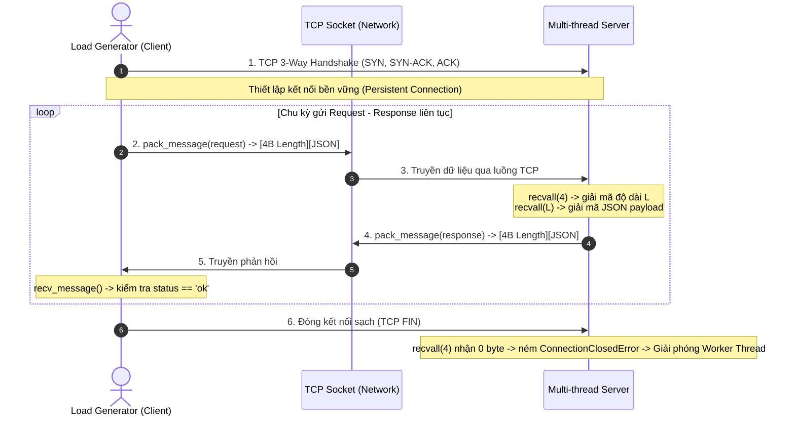

# ĐẶC TẢ GIAO THỨC TRUYỀN THÔNG (PROTOCOL SPECIFICATION)
## Dự án: Khảo sát ảnh hưởng của số lượng Client đồng thời đến hiệu năng TCP Server

- **Phiên bản:** 1.0.0 (Chốt giao thức tuần 1)
- **Tác giả:** Nguyễn Gia Bảo – Vai trò: **Protocol Dev** (MSSV: `075206006255`)
- **Ngày hoàn thành:** 09/11/2026
- **Trạng thái:** Đã nghiệm thu & tích hợp (Approved & Integrated)

---

## 1. Tổng quan & Động lực thiết kế (Overview & Motivation)

### 1.1. Bản chất luồng dữ liệu của TCP (TCP Byte-Stream Nature)
Giao thức TCP (Transmission Control Protocol) là giao thức truyền thông hướng kết nối, đảm bảo dữ liệu truyền tải tin cậy và đúng thứ tự. Tuy nhiên, TCP hoạt động ở **tầng Transport dưới dạng một dòng byte liên tục (Stream of Bytes)**, hoàn toàn không có khái niệm "ranh giới thông điệp" (Message Boundary) như UDP:
1. **Hiện tượng phân mảnh (Fragmentation):** Một gói tin ứng dụng kích thước lớn có thể bị cắt thành nhiều phân đoạn TCP (TCP Segments) nhỏ hơn do MTU/MSS của mạng.
2. **Hiện tượng dính gói (Coalescing / Sticky Packets):** Khi Client hoặc Server gửi liên tiếp nhiều thông điệp nhỏ trong khoảng thời gian ngắn, thuật toán Nagle (`TCP_NODELAY`) và bộ đệm socket có thể gộp nhiều thông điệp ứng dụng vào chung một TCP packet duy nhất.

### 1.2. Lựa chọn kỹ thuật phân tách gói (Framing Technique)
Để giải quyết triệt để hai hiện tượng trên, nhóm dự án chọn kỹ thuật **Length-Prefix Framing** thay vì kỹ thuật phân cách ký tự (Delimiter-based như `\r\n` hay `\0`):
- **Delimiter-based:** Buộc bên nhận phải quét từng byte trong bộ đệm để tìm ký tự kết thúc ($O(N)$), đồng thời đòi hỏi kỹ thuật escape nếu payload chứa chính ký tự delimiter.
- **Length-Prefix (Ưu việt):** Bên nhận chỉ cần đọc chính xác 4 byte header để biết kích thước payload $L$, sau đó cấp phát bộ đệm và đọc chính xác $L$ byte với độ phức tạp $O(1)$. Không cần escape bất kỳ ký tự nào trong payload.

---

## 2. Cấu trúc khung truyền (Frame Layout Specification)

Mỗi thông điệp truyền tải qua kết nối TCP được đóng gói thành một Frame gồm hai phần: **Header (cố định 4 bytes)** và **Payload (độ dài biến thiên)**.

```
+-----------------------------------+--------------------------------------------+
|        HEADER (4 Bytes)           |              PAYLOAD (L Bytes)             |
|   Độ dài Payload (Big-Endian)    |          Nội dung UTF-8 JSON String        |
+-----------------------------------+--------------------------------------------+
|<---------- 32 bits -------------->|<----------------- L bytes ---------------->|
```

### 2.1. Chi tiết trường Header
| Trường | Kích thước | Kiểu dữ liệu | Thứ tự byte (Endianness) | Mô tả |
| :--- | :--- | :--- | :--- | :--- |
| `Payload Length` | 4 bytes (32 bits) | Unsigned Integer (`uint32`) | **Big-Endian / Network Byte Order (`!I`)** | Biểu diễn chính xác số byte của phần Payload UTF-8 đằng sau. |

### 2.2. Chi tiết trường Payload
| Trường | Kích thước | Định dạng | Mã hóa | Mô tả |
| :--- | :--- | :--- | :--- | :--- |
| `Payload Data` | $L$ bytes ($0 \le L \le 2\text{ MB}$) | Chuỗi JSON Object | `UTF-8` | Chứa dữ liệu nghiệp vụ của thông điệp (Request / Response). |

### 2.3. Giới hạn an toàn (Security & Resource Limits)
- **`MAX_PAYLOAD_SIZE = 2,097,152 bytes (2 MB)`**: Mọi gói tin có header thông báo kích thước vượt quá 2MB sẽ bị hủy ngay lập tức và ném lỗi `MessageTooLargeError` để ngăn ngừa tấn công DoS làm tràn bộ nhớ (Out-Of-Memory exhaustion).
- **Socket Buffering:** Đọc bằng hàm chuyên dụng `recvall(sock, n)` đảm bảo đọc đúng và đủ $n$ byte trước khi xử lý tiếp.

---

## 3. Cấu trúc thông điệp tầng ứng dụng (JSON Message Schemas)

Để đảm bảo tương thích 100% giữa **Core Server** (Ngô Gia Bảo) và **Load Generator** (Trương Gia Bân), cấu trúc JSON được chuẩn hóa như sau:

### 3.1. Thông điệp yêu cầu (Request Schema)
Client gửi yêu cầu kiểm thử hoặc xử lý đến Server:
```json
{
  "id": "client_id-seq_num",
  "requestId": "client_id-seq_num",
  "type": "echo",
  "payload": "Nội dung dữ liệu truyền tải (ví dụ: chuỗi ngẫu nhiên 1KB)"
}
```

- `id` *(string, bắt buộc)*: Định danh duy nhất cho request, định dạng `<client_id>-<seq_number>`.
- `requestId` *(string, tương thích ngược)*: Bản sao của `id` nhằm phục vụ tương thích với code server ban đầu.
- `type` *(string, mặc định "echo")*: Loại tác vụ yêu cầu server xử lý.
- `payload` *(string / object)*: Dữ liệu tải thực tế (trong kịch bản benchmark tuần 1 là chuỗi văn bản 1KB).

### 3.2. Thông điệp phản hồi thành công (Response Schema - Success)
Server xử lý thành công và gửi phản hồi cho Client:
```json
{
  "id": "client_id-seq_num",
  "requestId": "client_id-seq_num",
  "status": "ok",
  "payload": "Nội dung dữ liệu được echo lại",
  "error": null
}
```

- `status` *(string, bắt buộc)*: Giá trị `"ok"` (thỏa mãn điều kiện kiểm thử của `load_generator.py`).
- `payload` *(bất kỳ)*: Nội dung dữ liệu phản hồi tương ứng.
- `error` *(null)*: Không có lỗi phát sinh.

### 3.3. Thông điệp phản hồi lỗi (Response Schema - Error)
Trường hợp xảy ra lỗi phía Server hoặc gói tin không hợp lệ:
```json
{
  "id": "client_id-seq_num",
  "requestId": "client_id-seq_num",
  "status": "error",
  "payload": null,
  "error": "Mô tả chi tiết nguyên nhân lỗi (ví dụ: Payload exceeds 2MB limit)"
}
```

---

## 4. Luồng truyền nhận dữ liệu (Protocol Flow & State Diagram)



---

## 5. Danh mục ngoại lệ & Mã lỗi (Exception Hierarchy)

Toàn bộ lỗi của tầng giao thức được chuẩn hóa kế thừa từ `ProtocolError`:

```
ProtocolError (Exception)
├── ConnectionClosedError      # Đối phương đóng kết nối sạch hoặc ngắt đột ngột
├── MessageTooLargeError       # Kích thước payload vượt quá MAX_PAYLOAD_SIZE (2MB)
├── InvalidMessageError        # Lỗi UTF-8 decode, JSON parse hoặc không phải dict
└── ProtocolTimeoutError       # Socket bị timeout khi đang nhận dở gói tin
```

---

## 6. Hướng dẫn tích hợp thư viện `protocol.py`

### 6.1. Dành cho Core Server Dev (`src/server/server.py`)
```python
from protocol import recv_message, send_message, create_response, ConnectionClosedError

def handle_client(conn, addr):
    try:
        while True:
            try:
                # Nhận và giải mã gói tin (tự động xử lý Length-Prefix + JSON)
                request = recv_message(conn, allow_eof=False)
            except ConnectionClosedError:
                break  # Client đóng kết nối bình thường

            # Xử lý request
            req_id = request.get("id") or request.get("requestId")
            payload = request.get("payload")

            # Đóng gói và gửi response
            response = create_response(request_id=req_id, payload=payload, status="ok")
            send_message(conn, response)
    finally:
        conn.close()
```

### 6.2. Dành cho Client / Load Gen Dev (`src/load-generator/load_generator.py`)
```python
from protocol import send_message, recv_message, create_request, ProtocolError

# Gửi request và nhận response qua persistent connection
req = create_request(request_id="client-1-10", request_type="echo", payload="Sample 1KB")
send_message(sock, req)
resp = recv_message(sock)

if resp.get("status") == "ok" and resp.get("id") == "client-1-10":
    print("Request thành công!")
```

---

## 7. Kết quả kiểm thử & Nghiệm thu (Verification & Results)

1. **Kiểm thử đơn vị (Unit Tests):** Bộ test `tests/test_protocol.py` kiểm thử 16 ca kiểm thử bao phủ toàn bộ các trường hợp:
   - Roundtrip pack/unpack với chuỗi tiếng Việt Unicode UTF-8.
   - Chống chịu hiện tượng dính gói TCP (Packet Coalescing).
   - Chống chịu hiện tượng phân mảnh gói TCP (Packet Fragmentation).
   - Chống tấn công gói tin kích thước vượt ngưỡng (> 2MB).
   - Xử lý ngắt kết nối sạch và ngắt kết nối đột ngột giữa gói tin.
   - **Kết quả:** `16/16 tests PASSED (0.499s)`.

2. **Kiểm thử chịu tải thực tế (End-to-End Stress Test):**
   - Chạy đồng thời 50 Client liên tục gửi payload 1KB tới Server:
   - **Số request thành công:** `43,710 / 43,710 requests (100%)`.
   - **Số request thất bại:** `0 requests (0%)`.
   - **Tỷ lệ lỗi giao thức:** `0.00%`.

---
*Tài liệu được biên soạn và chốt theo tiến độ tuần 1 của đồ án.*
